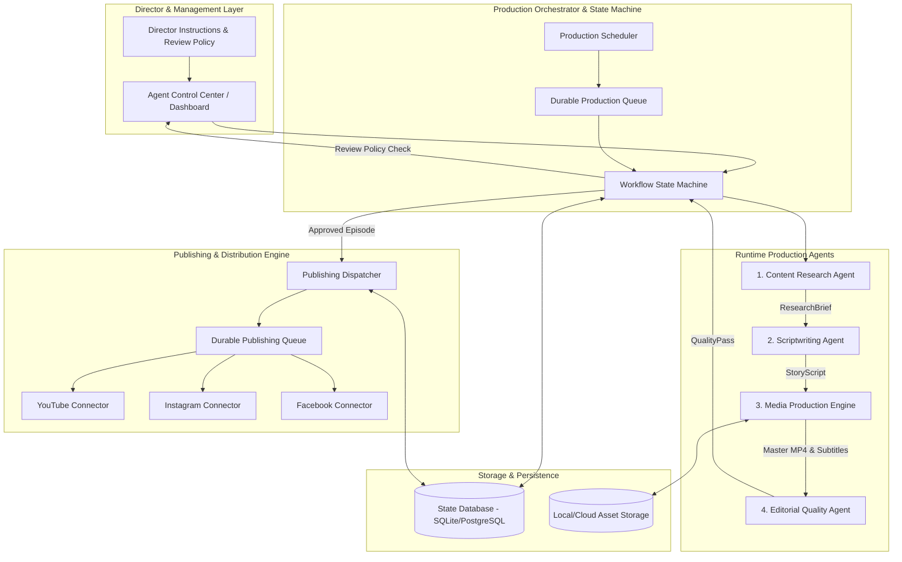

# VideoAutomater — Master System Architecture (V1.0)

## 1. Executive Summary & Vision

**VideoAutomater** is an enterprise-grade autonomous content engine and distribution platform designed to:
1. Conduct research on viral, educational, and fascinating topics across science, technology, engineering, space, and history.
2. Formulate tight, high-retention 80-second narrative scripts with verified hooks and evidence.
3. Render high-definition vertical master videos (1080x1920, 9:16, 30fps, H.264/AAC MP4) with dynamic pacing, motion graphics, clear voiceover narration, and word-accurate synchronized subtitles.
4. Distribute the **exact same master video** identically to multiple social media platforms and multiple accounts per platform (YouTube Shorts, Instagram Reels, Facebook Page Reels).
5. Empower the human Content Director via a web-based **Agent Control Center** to steer agents using natural-language instructions, configure production rates, inspect quality gates, and review or publish on demand.

---

## 2. Fundamental Architectural Principles

### 2.1 The Master Video Rule
$$\text{One Episode} \longrightarrow \text{One Master MP4} \longrightarrow \text{Multiple Selected Destinations}$$
- Render once at broadcast specification (`1080x1920`, 80s nominal duration, 30 fps, H.264 High Profile, AAC 48kHz audio).
- The exact same physical MP4 binary is dispatched to all selected destination accounts.
- Platforms receive platform-tailored metadata (titles, descriptions, tags, scheduled release windows), but the media binary is never re-encoded, watermarked, or altered per platform unless explicitly requested by the Director.
- Any destination that rejects the master format is marked `INCOMPATIBLE`, maintaining audit trail integrity.

### 2.2 Free-First, Sustainable Engineering
- Zero-cost operation baseline:
  - Free-tier Gemini APIs (with deterministic rate limiters and graceful backoff).
  - Open-source TTS / Edge TTS engine (local neural speech generation with offline fallback).
  - Rights-verified media acquisition (Wikimedia Commons, NASA, public domain, Creative Commons Zero) supplemented by programmatic SVG, Pillow, and Matplotlib animations.
  - Native FFmpeg rendering pipeline with filtergraphs for zoom/pan, crossfades, overlays, and typography.
- Hard safeguards: strictly prohibit paid third-party API dependencies or hidden billable cloud services without explicit Content Director authorization.

### 2.3 Deterministic First, LLM Where Necessary
- Multi-agent logic is partitioned into:
  - **Cognitive Agents** (LLM-driven: topic ranking, storytelling, hook optimization).
  - **Deterministic Services** (Python + FFmpeg: audio alignment, filtergraph compilation, schema validation, rate-limiting, OAuth token refresh, upload state machines).
- Avoid bloated external multi-agent frameworks; use clean, typed Python protocols, Pydantic schemas, and structured logging.

---

## 3. High-Level System Architecture Diagram

---

## 4. Subsystem Specifications

### 4.1 Viral Content Research Agent (`videoautomater.research`)
- **Discovery Engine**: Fetches and evaluates raw candidate topics from verified educational archives, pre-prints, curated scientific feeds, and historical databases.
- **Scoring Matrix**:
  - Curiosity and hook potential (25%)
  - Surprise and novelty (20%)
  - Visual storytelling potential (20%)
  - Audience relevance and shareability (15%)
  - Narrative depth (10%)
  - Freshness and originality (10%)
- **Factual Verification Gate**: Every candidate must link back to authoritative primary/secondary sources. Topics failing verification are rejected immediately.
- **De-duplication**: Semantic and vector similarity comparison against the persistent database of produced episodes prevents topic exhaustion or repetition.
- **Output**: Produces a strictly typed `ResearchBrief` containing 1 primary topic, 3 alternative hooks, verified facts, evidence citations, visual opportunities, and 2 backup topics.

### 4.2 Creative Scriptwriting Agent (`videoautomater.content`)
- **80-Second Narrative Architecture**:
  - `00–04s`: Instant visceral hook (no introductory greetings or channel logos).
  - `04–14s`: Core mystery / central question established.
  - `14–29s`: First revelation / unexpected turn.
  - `29–50s`: Escalation, evidence presentation, and deeper context.
  - `50–66s`: Climactic reveal or key breakthrough.
  - `66–80s`: Payoff, mind-expanding conclusion, and memorable thought.
- **Pacing**: Target spoken word count of 165–185 words (2.1 to 2.3 words/second), calibrated against measured TTS cadence.
- **Output**: Validated `StoryScript` with exact sentence-level visual intent markers.

### 4.3 Media Production Engine (`videoautomater.visuals`, `audio`, `rendering`)
- **Asset Acquisition & Synthesis**:
  - Searches licensed and public domain visual archives (NASA, Wikimedia, Pexels/Pixabay free tier).
  - Synthesizes programmatic 1080x1920 visuals (data charts, scientific schematics, kinetic particle backgrounds, animated maps) using Pillow, SVG, and Matplotlib.
- **Narration Engine**: Generates natural, authoritative English speech with accurate phonetic pronunciation and audio normalization (EBU R128 loudness targeting -14 LUFS).
- **Subtitle Aligner**: Performs word-level audio alignment to produce `.srt` and `.ass` subtitles styled for vertical mobile viewing (bold, centered in the lower-middle safe zone, high contrast outline, kinetic highlighting).
- **FFmpeg Master Renderer**:
  - Assembles visuals, background ambient audio, voiceover, and captions into a seamless 80-second vertical MP4.
  - Employs smooth zoom/pan (Ken Burns), dynamic crossfades, and visual cuts every 2.5–4.0 seconds.

### 4.4 Editorial Quality Agent (`videoautomater.quality`)
- **Content Accuracy**: Verifies script claims against the source brief.
- **Technical Validation**:
  - Duration check: $80.0\text{s} \pm 2.0\text{s}$.
  - Resolution: Exactly $1080 \times 1920$ pixels.
  - Codec integrity: Video H.264 (yuv420p), Audio AAC.
  - Audio loudness: Integrated LUFS within $[-16, -13]$ range.
  - Subtitle synchronicity: Zero drift, safe margin from UI edges.
  - Bitrate & Playability: Moov atom at front (`+faststart`), playable in standard players.

### 4.5 Publishing & Distribution Engine (`videoautomater.publishing`)
- **Generic Connector Contract**: Pluggable interface (`BasePlatformConnector`) implementing auth validation, quota verification, media validation, chunked resumable upload, publication scheduling, and permalink polling.
- **Destination Registry**: Supports unlimited accounts per platform (e.g., YouTube Channel 1, YouTube Channel 2, Instagram Account A).
- **Publishing Groups**: Logical grouping (e.g., "Science Network", "History Channel").
- **Durable Delivery**: Separate state tracking for each account upload. A failure on Instagram will never cause a re-upload to YouTube.

### 4.6 Production Orchestrator & State Machine (`videoautomater.orchestration`)
- **State Machine Stages**:
  `CREATED` $\rightarrow$ `RESEARCHING` $\rightarrow$ `SCRIPTING` $\rightarrow$ `GENERATING_MEDIA` $\rightarrow$ `RENDERING` $\rightarrow$ `QUALITY_CHECK` $\rightarrow$ `AWAITING_REVIEW` $\rightarrow$ `APPROVED` $\rightarrow$ `DISPATCHED` $\rightarrow$ `PUBLISHED`.
- **Review Policies**:
  - `AUTO_PUBLISH`: Automatically moves to `DISPATCHED` upon quality clearance.
  - `OPTIONAL_REVIEW`: Alerts Director; if no response by deadline, auto-publishes.
  - `REQUIRED_APPROVAL`: Halts at `AWAITING_REVIEW` until explicit human sign-off.

---

## 5. Technology Stack & Dependencies

| Layer | Technology | Rationale |
|---|---|---|
| Runtime | Python 3.10+ / 3.11+ | Clean, typed asynchronous ecosystem |
| Models | Gemini API (2.5 / 1.5 Flash Free Tier) | High reasoning, large context, zero-cost tier |
| Narration / Audio | Edge-TTS / pyttsx3 / soundfile | High quality neural voiceover, free, offline capable |
| Image Processing | Pillow, Matplotlib, SVGwrite | Programmatic high-res graphics generation |
| Video Rendering | FFmpeg (via system or imageio-ffmpeg) | Fast, industry-standard video compilation |
| Schemas / Validation | Pydantic v2 | Strict serialization and runtime contracts |
| Database | SQLite (Dev/Local) / Postgres (Cloud) | Durable ACID state without heavyweight infra |
| Web Dashboard | FastAPI + Vanilla Modern CSS/JS | Lightweight, responsive Director's Console |
| Testing | Pytest, pytest-asyncio, pytest-cov | High coverage, deterministic mocks and fixtures |
